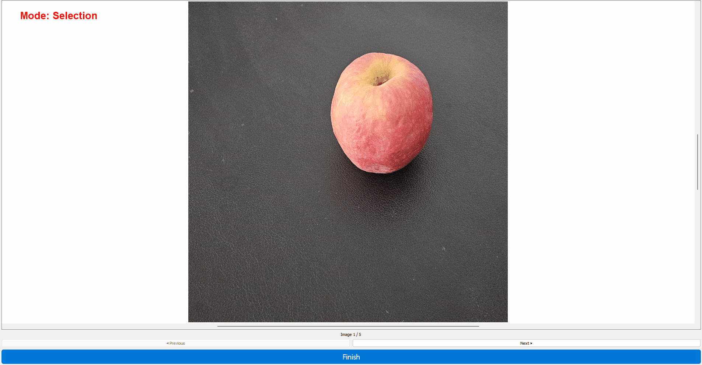
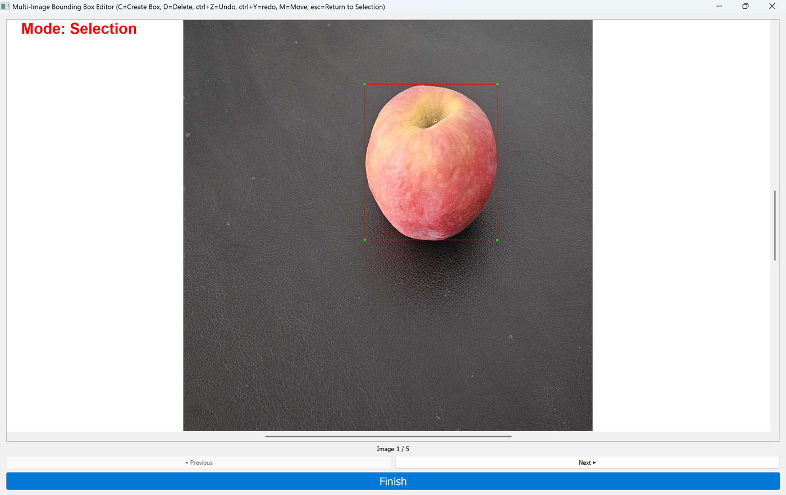
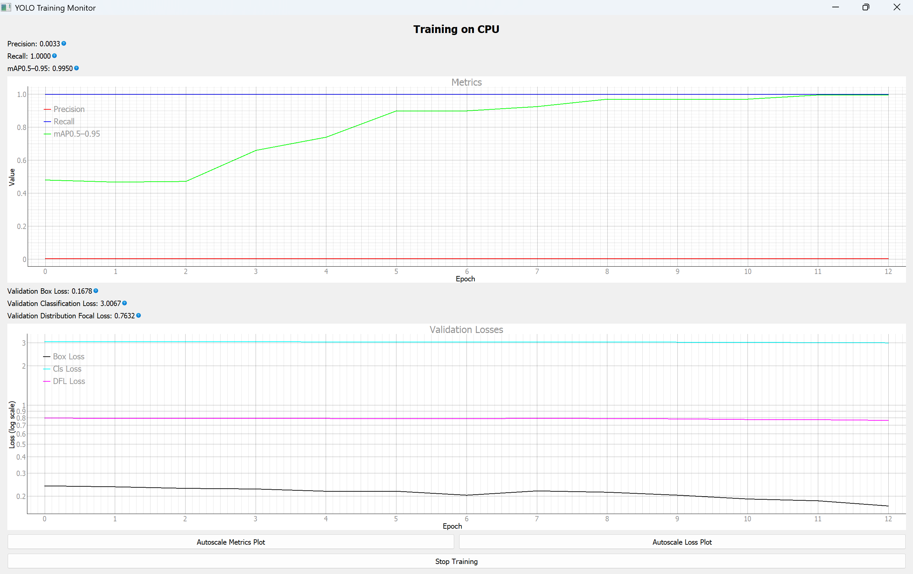
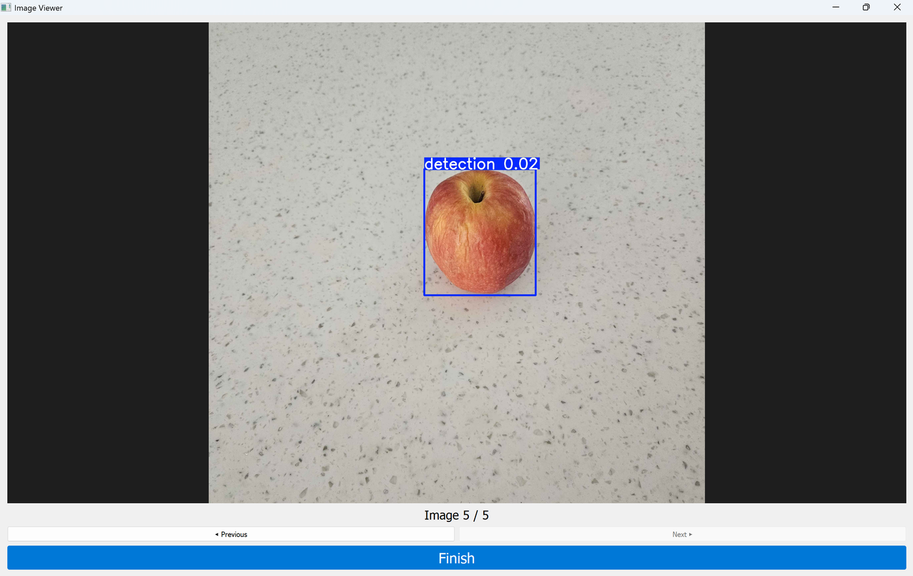
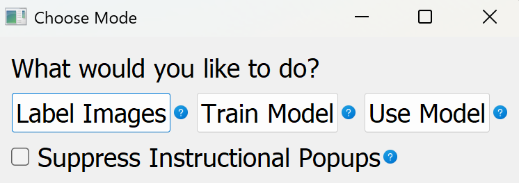
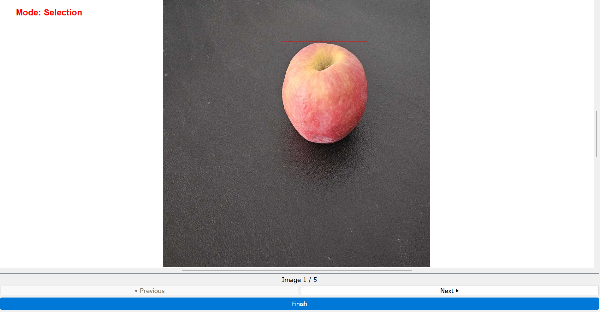
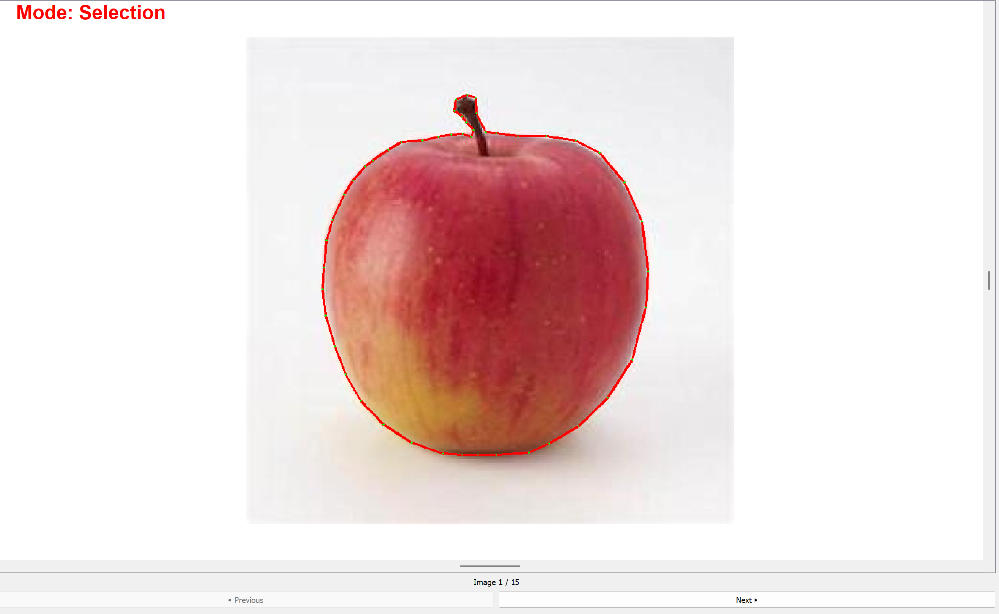
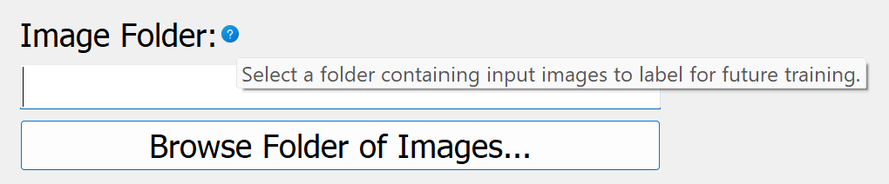
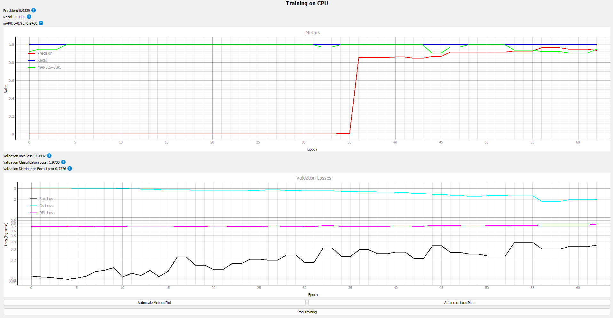
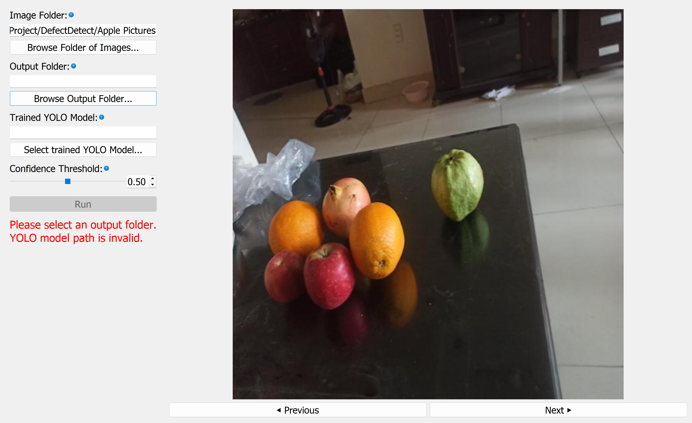

# YOLOEZ

[](https://github.com/michaelholm6/YOLOEZ/actions/workflows/test.yml?query=branch:main) [](https://github.com/michaelholm6/YOLOEZ/releases) [](LICENSE)

**Label, train, and run object detection and segmentation models on your own images: no code, no cloud. Everything runs on your own computer, powered by Ultralytics YOLO11.**

Built for researchers, students, and engineers with image data (microscopy, defect inspection, biology, field photos) who want a modern deep learning model without setting up a Python environment or sending data anywhere. Your images never leave your machine.



**[Download for Windows or Linux](https://github.com/michaelholm6/YOLOEZ/releases)** · macOS: [run from source](#running-from-source)

---

## Table of Contents

1. [What It Does](#what-it-does)
2. [System Requirements](#system-requirements)
3. [Getting Started](#getting-started)
4. [Quick Start Example](#quick-start-example)
5. [Screenshots and Visual Examples](#screenshots-and-visual-examples)
6. [Running from Source](#running-from-source)
7. [Testing](#testing)
8. [Linux Remote Desktop Setup](#linux-remote-desktop-setup)
9. [Repository Structure](#repository-structure)
10. [Citing YOLOEZ](#citing-yoloez)
11. [License](#license)

---

## What It Does

YOLOEZ walks you through three workflows, each reachable from a single starting menu, no scripting or manual configuration required:

- **Label:** draw bounding boxes or polygon segmentation masks on your images. An optional area-of-interest mask lets you exclude irrelevant regions before labeling, and bootstrap labeling can generate a starting set of annotations from an existing model for you to correct.
- **Train:** choose a model size, configure data augmentation through checkboxes, and start training with one click. There are no config files or epoch counts to guess: you watch live loss and metric plots and stop whenever the curves flatten.
- **Infer:** load a trained model, run it on new images, and browse annotated results and structured JSON output in a built-in viewer.

Every step includes tooltips, instructional popups, and validation messages, so first-time users do not need prior experience with YOLO or machine learning pipelines.

This tool is intended for researchers, students, engineers, and anyone else who wants to train and use YOLO11 models without writing code.

---

## System Requirements

- Windows, Linux, or macOS (macOS currently requires running from source; see [Running from Source](#running-from-source))
- When running on a headless Linux server, a remote desktop must be used to interact with the GUI; see [Linux Remote Desktop Setup](#linux-remote-desktop-setup)
- GPU recommended for training but not required
- Sufficient disk space for datasets and trained models

Exact requirements may vary depending on dataset size and model configuration.

---

## Getting Started

No installation or environment setup is required to use the prebuilt executables.

(NOTE: If you're trying to run this on a Linux remote desktop, reference [this guide](#linux-remote-desktop-setup) first.)

1. Navigate to the [**Releases**](https://github.com/michaelholm6/YOLOEZ/releases) section of this repository, located on the right side of the GitHub page.
2. Download the latest release for your operating system. If downloading for Linux, download all numbered zip files.
   NOTE: If downloading for Linux, refer to [this section](docs/linux-remote-desktop-setup.md#6-combine-the-split-zip-files-into-a-single-zip) for guidance on combining multiple zip files.
3. Extract the downloaded zip file.
4. Launch the executable included in the extracted folder.
5. NOTE: You must keep the executable file in the same directory as the _internal folder.

The application will start immediately and guide you through the available workflows.

---

## Quick Start Example

This example walks through one complete label → train → infer cycle using the five sample images bundled in [`assets/test_images/`](assets/test_images), each showing a single apple photographed against a dark background. It is deliberately small: the goal is to confirm YOLOEZ works end to end on your machine and to show the shape of the workflow, not to produce a useful model.

Every step below is also explained by instructional popups inside the application, so you do not need to keep this page open while you work.

**What you will produce:** a bounding box detector for a single class, trained on five images.

> **This example is a tour of the interface, not a demonstration of model quality.** Five training images, no held-out test set, and a validation set of one make every metric here noise by design: the run reaches recall 1.0 at precision 0.003, the signature of a model firing indiscriminately. It is built to finish in a few minutes, not to be a valid study. See [Applying this to your own data](#applying-this-to-your-own-data) for a result that is.

---

### Step 1: Label the images

1. Launch YOLOEZ and click **Label Images** on the "What would you like to do?" dialog.
2. Click **Browse Folder of Images...** and select `assets/test_images/`. The images appear in the preview pane; use **◀ Previous** and **Next ▶** to page through them.
3. For the annotation mode, select **Bounding Boxes**.
4. Tick **Save YOLO Training Sample** so the run writes a YOLO-format dataset.
5. Click **Browse Output Folder...** and choose where results should go.
6. Click **Run**.
7. **Area of interest:** you will be asked to outline the regions worth labeling. For this example you can skip it by just clicking **Finish**. Leaving an image unmarked uses the whole image.
8. **Bounding box editor:** press `C`, then click once on each of two opposite corners of a box around the apple. Repeat for each image, then click **Finish** to save your labels. Closing the window with the X discards them.



Your output folder now contains:

<pre>
output_folder/
├── box_visualizations/   # PNGs showing the boxes drawn on each image
└── yolo_dataset/         # The training dataset: one .png and one .txt per image
</pre>

Each `.txt` holds one line per object in YOLO format, as `class x_center y_center width height`, normalized to a 0–1 range:

```
0 0.606152 0.347836 0.323312 0.382597
```

A reference copy of this output ships in [`assets/test_labels/`](assets/test_labels) if you want to compare against it.

---

### Step 2: Train a model

1. Return to the start dialog and click **Train Model**.
2. Click **Browse Training Dataset...** and select the `yolo_dataset/` folder from Step 1. YOLOEZ infers automatically from the label format that this is a detection dataset rather than a segmentation one.
3. Choose a model size. **Nano** trains fastest and is the right choice here.
4. Under **Apply Data Augmentations**, tick all five available options (**Flip**, **Color Jitter**, **Blur**, **Noise**, and **Scale**) and set **Augmentations per image** to `3`. **Rotate** is hidden automatically, because rotating an image would invalidate its axis-aligned bounding boxes.
5. Leave **Train/Test Split (% for training)** at its default of 80.
6. Click **Browse Save Directory...** to choose where the training run is written, then click **Run**.

YOLOEZ does not ask you for a number of epochs. Training runs continuously and you decide when to stop it: watch the live metric and loss plots, and click **Stop Training** once the curves have flattened out. The best-performing weights are what get saved, so stopping later than necessary costs time but not accuracy.

The run is written to a `YOLO_EZ_training/` folder inside the save directory you chose, and the weights land in its `weights/` subfolder:

- **`best.pt`**: the checkpoint that scored best on the validation set during the run. This is the file to use for inference.
- **`last.pt`**: the checkpoint from the final epoch, whatever its score. It is kept so a run can be continued from where it stopped, using **Continue Training from Model**.

The two differ whenever the final epoch was not the best one, which is the usual case once the curves have flattened and started to wander. If a `YOLO_EZ_training/` folder already exists, a number is appended (`YOLO_EZ_training2`, and so on), so the newest run is the highest-numbered folder.

The panel header shows whether the run is using your **GPU** or falling back to **CPU**. On this five-image dataset, a Nano model on CPU trains fast enough that the plots update every few seconds; the run shown below was stopped after a dozen epochs.



> **Note:** the near-perfect mAP above reflects how trivially separable one large apple on a plain background is, and is measured against a validation set of one image. These are the numbers a five-image dataset produces, not the numbers YOLOEZ produces.

---

### Step 3: Run inference

1. Return to the start dialog and click **Use Model**.
2. Click **Select trained YOLO Model...** and choose `best.pt` from Step 2, found under `YOLO_EZ_training/weights/` inside the save directory you picked.
3. Click **Browse Folder of Images...** and select `assets/test_images/` again. These are the same images the model trained on, so the detections below show only that the pipeline runs end to end. They are not a measure of accuracy.
4. Set the **Confidence Threshold** to `0.02`. This is far lower than you would use in practice; a model trained on five images produces weak, low-confidence predictions, so a normal threshold would filter everything out.
5. Click **Browse Output Folder...**, then click **Run**.

The annotated images, alongside a JSON file per image describing each detection, are written to the output folder and then opened in a built-in viewer.



---

### Applying this to your own data

The same three steps apply to any image set: point Step 1 at your own folder instead of `assets/test_images/`. Real datasets need considerably more than five images, but likely fewer than you would expect. In a published structural health monitoring study, YOLOEZ was used to train a segmentation model on 20 labeled electron microscope images, achieving results competitive with a classical morphological baseline tuned across 780 parameter combinations ([Holm et al., SMASIS 2026](https://arxiv.org/abs/2608.25176)).

---

## Screenshots and Visual Examples

### Main Application Window


### Bounding Box Annotation Example


### Segmentation Mask Example


### Tooltip Example


### Training Performance Panel


### Inference Preparation View


---

## Running from Source

Most users should use the prebuilt executables described above. Running from source is intended for anyone who wants to use the latest development code, modify YOLOEZ, or review the project.

**Requirements:** Python 3.12 or newer, `git`, and a graphical display.

Check your interpreter before starting: `python3 --version` on Linux and macOS, `py --version` on Windows. If it is older than 3.12, install a newer one first; the [Python Version](CONTRIBUTING.md#python-version) section of CONTRIBUTING.md covers how to do that on each platform, including options that need no administrator access.

### Linux and macOS

The quickest route is [uv](https://docs.astral.sh/uv/), which downloads and manages Python 3.12 for you, so no system Python is involved:

```bash
git clone https://github.com/michaelholm6/YOLOEZ.git
cd YOLOEZ
uv sync --extra dev --python 3.12
uv run python src/main.py
```

Or, using a virtual environment and `pip`:

```bash
git clone https://github.com/michaelholm6/YOLOEZ.git
cd YOLOEZ

python3.12 -m venv .venv
source .venv/bin/activate

python -m pip install --upgrade pip
pip install -e ".[dev]"

python src/main.py
```

Naming the interpreter explicitly as `python3.12` matters: on distributions whose default `python3` is older, a plain `python3 -m venv` builds an environment YOLOEZ cannot be installed into.

### Windows

Use a virtual environment and `pip`. The uv route above does **not** work here. See the note below.

```powershell
git clone https://github.com/michaelholm6/YOLOEZ.git
cd YOLOEZ

py -3.12 -m venv .venv
.venv\Scripts\activate

python -m pip install --upgrade pip
pip install -e ".[dev]"

python src/main.py
```

### Why the two paths differ

PyQt5's Qt binaries (`pyqt5-qt5`) publish no Windows wheels at the version uv resolves to, so `uv sync` fails on Windows with a "no source distribution or wheel for the current platform" error. `pip` selects a compatible older version and installs correctly. This is also why PyQt5 is declared in the `[dev]` extra rather than among the core dependencies.

On Linux and macOS the same package does ship wheels, so uv works there.

### Notes

The first training or inference run downloads the relevant pretrained YOLO11 weights automatically, so an internet connection is needed the first time.

YOLOEZ is a graphical application and requires a display. To run it on a headless Linux machine, see [Linux Remote Desktop Setup](#linux-remote-desktop-setup).

---

## Testing

YOLOEZ includes an automated test suite built with `pytest` that exercises all three workflows end to end against a small bundled dataset, without requiring a visible display.

After installing from source as described above, run the full suite from the repository root:

```bash
pytest
```

If you set the project up with uv, prefix commands with `uv run`:

```bash
uv run pytest
```

On a headless Linux machine, the Qt tests need an offscreen platform plugin and a virtual display:

```bash
QT_QPA_PLATFORM=offscreen xvfb-run -a python -m pytest
```

Other useful commands:

```bash
# Run a single test
pytest tests/test_cases.py::test_workflows_end_to_end -v

# Run the suite with a coverage report
python -m pytest --cov=src --cov-report=xml

# Check formatting the way CI does
black --check .
```

The same suite runs automatically in continuous integration on both Ubuntu and Windows (Python 3.12) for every push and pull request to `main` and `development`, together with a Black formatting check. Current status is shown by the badge at the top of this README.

---

## Linux Remote Desktop Setup

Running YOLOEZ on a headless Linux server, for example an HPC cluster, requires a remote desktop, since YOLOEZ is a graphical application. See [docs/linux-remote-desktop-setup.md](docs/linux-remote-desktop-setup.md) for a full walkthrough that sets up a lightweight XFCE desktop with TightVNC and connects to it from Windows using RealVNC Viewer.

---

## Repository Structure
<pre>
├── src/                  # Application source code
├── tests/                # Test suite
├── assets/               # Icons, and the sample images used by the Quick Start Example
├── images/               # README images and screenshots
├── docs/                 # Additional guides (e.g. Linux remote desktop setup)
├── .github/              # Issue templates and CI workflows
├── AUTHORS.md            # Authors and contributors
├── CITATION.cff          # Machine-readable citation metadata
├── CODE_OF_CONDUCT.md    # Expected conduct in this repository
├── CONTRIBUTING.md       # How to contribute, and development setup
├── LICENSE               # AGPL-3.0 license text
├── README.md             # This file
├── paper.md              # Software paper describing YOLOEZ
├── paper.bib             # Bibliography for the software paper
├── pyproject.toml        # Project metadata and dependencies
├── pytest.ini            # Test configuration
└── uv.lock               # Resolved dependency versions for uv
</pre>

---

## Citing YOLOEZ

If YOLOEZ is useful in your research, please cite our paper rather than the repository directly. A preprint is being prepared for arXiv; once it is posted, the citation (including its arXiv identifier and DOI) will be added here.

---

## License

This project is licensed under the AGPL-3.0 License – see the [LICENSE](LICENSE) file for details.
