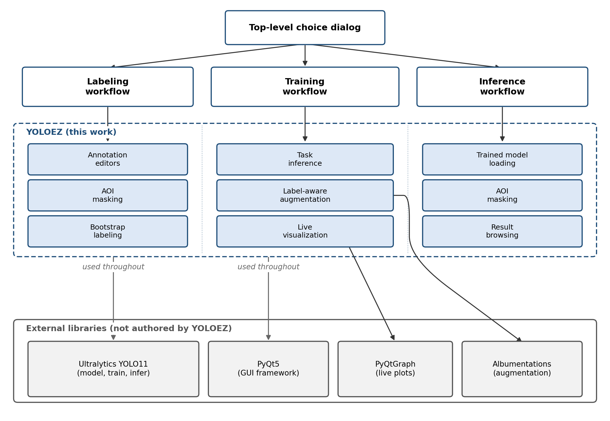
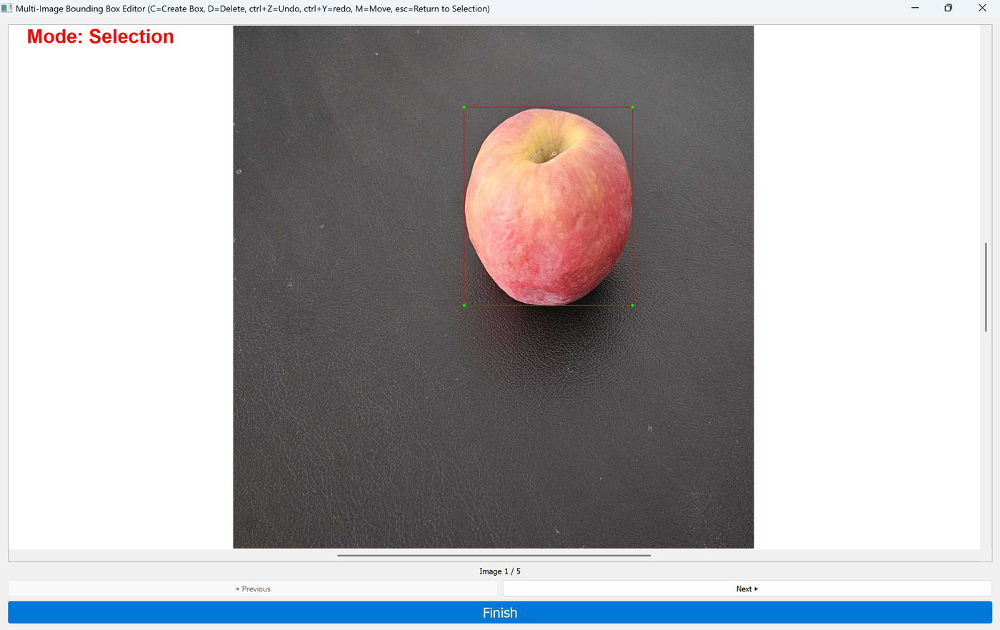
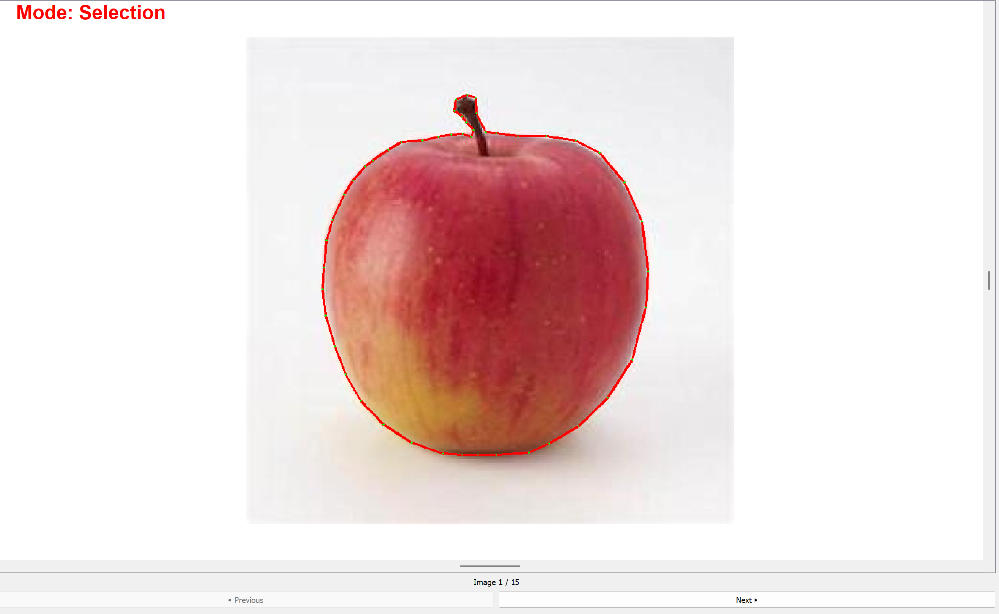
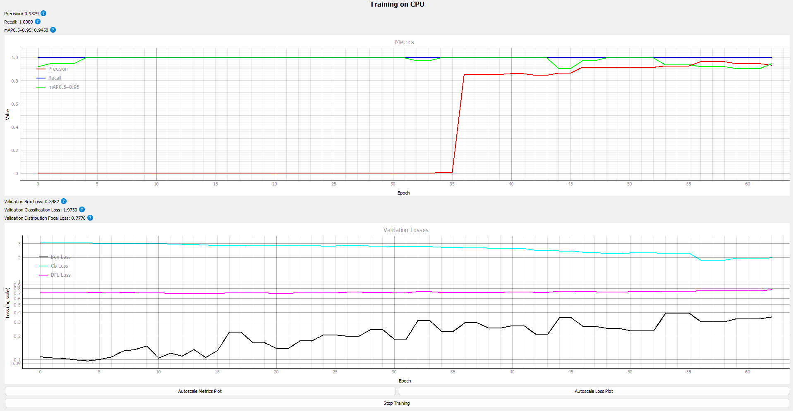
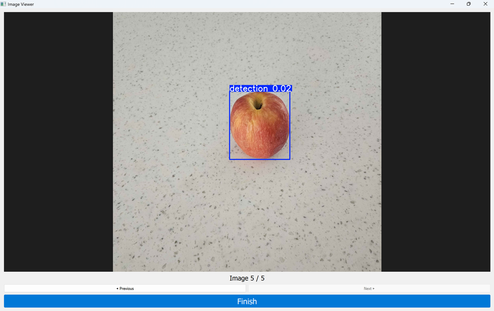

# Summary

YOLOEZ is an open-source, cross-platform desktop application that provides a complete, no-code pipeline for developing and deploying YOLO11 (You Only Look Once) [@Jocher_Ultralytics_YOLO_2023] computer vision models. The application guides users through three independent workflows: dataset labeling, model training, and inference. All functionality is exposed through a graphical interface built with PyQt5 [@pyqt5], eliminating the need for command-line interaction or Python programming. YOLOEZ supports both bounding-box object detection and polygon-based instance segmentation tasks, and is distributed as a standalone executable for Windows and Linux that requires no Python installation.

# Statement of Need

State-of-the-art object detection and segmentation models have become accessible to the broader research community through frameworks such as Ultralytics YOLO [@Jocher_Ultralytics_YOLO_2023], yet the practical barrier to using these tools remains high for domain experts without programming backgrounds. Engineers and materials scientists characterizing defects in manufactured parts have long relied on classical image-processing methods such as thresholding and morphological operations [@landstrom2012]. Training a deep learning model today instead requires Python proficiency, familiarity with dataset formats, and knowledge of training configuration that many lack. More broadly, biologists, medical researchers, and other domain experts with labeled or unlabeled image data face the same barrier: existing options either require programming skill or process data on external servers, which is often incompatible with data-governance requirements for sensitive, proprietary, or patient-related research. YOLOEZ was developed to address this gap, allowing a researcher with image data and domain knowledge to train and deploy a state-of-the-art detection or segmentation model without writing a single line of code, on their own hardware.

# State of the Field

The tools most relevant to YOLOEZ fall into four categories, summarized in Table 1.

**Annotation-only tools:** CVAT [@cvat2022] and LabelImg [@tzutalin2015labelimg] support YOLO-format export but offer no training or inference; LabelImg is limited to bounding boxes and has been archived since 2024. LabelMe [@wada2024labelme] also offers no training or inference and supports polygon annotation, but exports to VOC or COCO format rather than YOLO directly. Label Studio [@labelstudio2020] adds broader ML-backend integration but requires a running server.

**Cloud platforms:** Roboflow [@dwyer2026roboflow] and Ultralytics Platform (formerly Ultralytics HUB) [@ultralyticshub] offer end-to-end pipelines but require an account and process data on external servers. As of October 2026, Roboflow's free tier keeps projects private by default and includes model weight download. Roboflow's open-source Inference framework can run trained models on the user's own hardware, but this requires installing and configuring an inference server (typically through Docker and a command-line tool, or a native desktop app on Windows and macOS) and writing code to query it, so it demands considerable technical knowledge. Only inference can be self-hosted this way: labeling and training are still performed on Roboflow's servers.

**Browser-based tools:** Google Teachable Machine [@teachablemachine] trains client-side, so data stays on the user's device, but supports only whole-image, audio, or pose classification, not object localization or segmentation. Microsoft Custom Vision [@customvision] processes data on Azure servers; Microsoft has announced its retirement, recommending migration by September 2026 ahead of full shutdown in September 2028.

**CLI and scripting tools:** The Ultralytics Python package and CLI [@Jocher_Ultralytics_YOLO_2023] provide complete control without writing Python code, but still require comfort with package installation and manual dataset preparation.

+--------------------------+----------------+----------+----------+----------+----------+----------+
| Tool                     | Local          | No-code  | Label    | Train    | Infer    | Segment  |
+==========================+================+==========+==========+==========+==========+==========+
| CVAT                     | Yes            | Yes      | Yes      | No       | No       | Yes      |
+--------------------------+----------------+----------+----------+----------+----------+----------+
| LabelImg                 | Yes            | Yes      | Yes      | No       | No       | No       |
+--------------------------+----------------+----------+----------+----------+----------+----------+
| Label Studio             | Self-hosted    | Yes      | Yes      | No       | No       | Yes      |
+--------------------------+----------------+----------+----------+----------+----------+----------+
| Roboflow                 | Infer only     | Yes      | Yes      | Yes      | Yes      | Yes      |
+--------------------------+----------------+----------+----------+----------+----------+----------+
| Ultralytics Platform     | No             | Yes      | Yes      | Yes      | Yes      | Yes      |
+--------------------------+----------------+----------+----------+----------+----------+----------+
| Teachable Machine        | Yes            | Yes      | Yes      | Yes      | Yes      | No       |
+--------------------------+----------------+----------+----------+----------+----------+----------+
| Custom Vision            | No             | Yes      | Yes      | Yes      | Yes      | No       |
+--------------------------+----------------+----------+----------+----------+----------+----------+
| Ultralytics CLI          | Yes            | No       | No       | Yes      | Yes      | Yes      |
+--------------------------+----------------+----------+----------+----------+----------+----------+
| **YOLOEZ**               | **Yes**        | **Yes**  | **Yes**  | **Yes**  | **Yes**  | **Yes**  |
+--------------------------+----------------+----------+----------+----------+----------+----------+

Table: Comparison of tools relevant to YOLOEZ. \label{tab:comparison}

CVAT and Label Studio are server-based web applications; adding a local, no-code training workflow would mean reworking their client-server architecture. LabelMe's lightweight desktop design is architecturally closer to YOLOEZ but has no infrastructure for managing training runs. To our knowledge, before YOLOEZ, no existing tool combines a fully local, no-code, end-to-end labeling, training, and inference workflow with segmentation support.

# Software Design

YOLOEZ is organized around three independent workflows, each implemented as a separate package and accessible through a top-level choice dialog (\autoref{fig:main}).

Ultralytics supplies the model definitions and the training and inference routines; the remaining functionality is implemented in YOLOEZ: augmentation with coordinate-consistent label transforms, area-of-interest masking, bootstrap labeling, the interactive annotation editors, automatic task inference, live training visualization, and result browsing. YOLOEZ is distributed as standalone Windows and Linux executables built with PyInstaller, and can also be built and run directly from source.

**Labeling workflow:** Users select a folder of images and optionally provide a pre-trained YOLO model for bootstrap labeling, where the model generates an initial set of labels that the user then corrects rather than creating them all from scratch. An area-of-interest (AOI) mask, drawn as a polygon, blacks out irrelevant image regions before annotation begins, reducing the labeling burden for images with large uniform backgrounds or many instances of the object of interest; masked images are then used like any other image throughout training, with no special handling of the blacked-out regions. Users then refine bounding boxes or polygon contours in interactive editors (\autoref{fig:labeling} and \autoref{fig:segmentation}), with undo/redo, lasso selection, and zoom options. Labels are saved in YOLO format alongside the source images.

**Training workflow:** Users select a labeled dataset, choose a model size (nano through extra-large), configure data augmentation via checkboxes, and set a train/validation split. The dataset task type (detection or segmentation) is automatically inferred from label file structure, and malformed or inconsistent label files are rejected with an error dialog. Each run starts from Ultralytics' pre-trained YOLO11 checkpoint for the chosen model size and task, and is executed via the Ultralytics application programming interface (API) [@Jocher_Ultralytics_YOLO_2023] in a background thread, using a GPU automatically if one is available and otherwise the CPU, with live loss and metric plots rendered using PyQtGraph [@pyqtgraph] (\autoref{fig:training}). Augmentation uses the Albumentations library [@buslaev2020], with coordinate transforms applied consistently to both images and their labels.

**Inference workflow:** Users load a trained `.pt` model and a folder of images, optionally apply an AOI mask, run inference, and browse results in a built-in viewer (\autoref{fig:inference}) before saving annotated images and structured JSON (JavaScript Object Notation) output.

## Design decisions

The design of YOLOEZ reflects deliberate trade-offs in favor of accessibility over flexibility, each motivated by the target audience of non-programmers.

**Pre-trained architectures only.** YOLOEZ restricts users to the standard Ultralytics YOLO11 model family (nano through extra-large) and does not expose custom architecture definition. Allowing users to modify network architecture would require understanding of layer types, parameter counts, and GPU memory constraints, which are outside the scope of the intended user. The five size variants span lightweight to high-accuracy configurations.

**No remote training.** YOLOEZ runs training only on the local machine and does not support submitting jobs to a remote GPU server. Configuring SSH (Secure Shell) credentials, remote paths, and job schedulers inside a graphical interface would significantly increase interface complexity for a capability that most target users do not need.

**Restricted input file types.** Accepted image formats are limited to JPEG, PNG, BMP, and TIFF. This excludes some scientific formats but keeps the label-train-infer pipeline free of format-specific edge cases that would be opaque to non-programmers.

**Automatic task detection.** Rather than asking users to specify whether their dataset is a detection or segmentation dataset, YOLOEZ infers this from the coordinate count in label files. This eliminates one potential misconfiguration error.

**Rotation augmentation disabled for detection.** YOLO detection labels encode axis-aligned bounding boxes. Applying arbitrary rotation augmentation to detection data would produce boxes that no longer tightly bound the rotated objects, so the rotation option is automatically disabled and hidden when a detection dataset is loaded.

# Research Impact Statement

YOLOEZ was developed at Purdue University and has been applied in structural health monitoring research. A study by the present authors used YOLOEZ to train a YOLO11 segmentation model, from only 20 labeled images, to detect micro-scale cracks in scanning electron microscope images of additively manufactured tungsten, achieving results competitive with a classical morphological baseline tuned across 780 parameter combinations [@holm2026smasis].

# Open-Source Software Practices

YOLOEZ (v0.7.0) follows established open-source practices: a 1,700-line pytest [@pytest] and pytest-qt [@pytestqt] suite reaching 74% coverage exercises all three workflows against a synthetic dataset in headless mode, and continuous integration runs on Ubuntu and Windows via GitHub Actions, enforcing Black formatting and generating coverage reports on every push. The repository includes CONTRIBUTING.md, CODE_OF_CONDUCT.md, and a labeled issue tracker. The software has been under public development since August 2025, with seven public releases, and is licensed under AGPL-3.0, matching the license of the Ultralytics YOLO dependency it builds on.

# AI Usage Disclosure

Generative AI tools were used in three areas of this work:

- **Code:** GitHub Copilot (version 1.24.0) was used for inline code completion assistance during software development. Claude (Anthropic; Claude Sonnet 5 and Claude Opus 5.5) was additionally used for targeted source changes and continuous integration workflow configuration. All generated code was reviewed, tested, and validated by the authors before inclusion.

- **Paper and documentation:** Claude was used to assist with drafting paper text, writing source code docstrings, and drafting repository documentation. All AI-assisted text was reviewed and edited by the authors.

- **Repository management:** Claude was used to draft GitHub issues and pull request descriptions, prepare commit messages, and carry out routine repository operations such as branch merges. All such actions were directed and approved by the authors.

The authors made all core design decisions, defined the problem framing and architecture, and reviewed, edited, and validated all AI-assisted outputs. The authors remain fully responsible for the accuracy, originality, licensing, and ethical and legal compliance of the submitted work.

# Acknowledgements

Development was supported by Purdue University. The authors thank the Ultralytics team for their open-source YOLO11 implementation.

GL acknowledges support from the National Science Foundation (DMS-2533878, DMS-2053746, DMS-2134209, ECCS-2328241, CBET-2347401, and OAC-2311848) and the U.S. Department of Energy, Office of Science, Advanced Scientific Computing Research program (DE-SC0023161; SciDAC LEADS Institute) and Fusion Energy Sciences (DE-SC0024583).

This material is based upon work supported by the Air Force Office of Scientific Research under award number FA9550-25-C-B010 in the amount of \$139,700.

The funders had no role in the design of the software, the preparation of the paper, or the decision to publish.

# Conflicts of Interest

The authors declare no conflicts of interest.

# References
